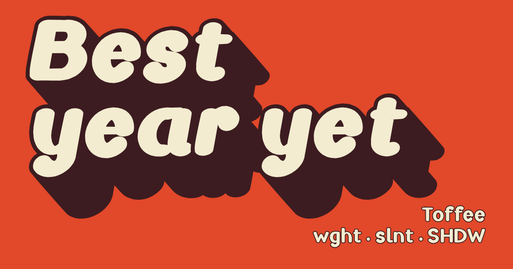

# Toffee

A heavy, rounded display face built as a COLRv1 variable font. The style is taken from a "Best year yet" door sign; the glyphs are original.

**Demo:** https://lukehmu.github.io/toffee/ lets you type in it and set every axis and colour.



**Download:** [Toffee[SHDW,slnt,wght].woff2](https://github.com/lukehmu/toffee/raw/main/fonts/Toffee%5BSHDW,slnt,wght%5D.woff2)
for the web, [Toffee[SHDW,slnt,wght].ttf](https://github.com/lukehmu/toffee/raw/main/fonts/Toffee%5BSHDW,slnt,wght%5D.ttf)
for desktop apps.

Axes:
- `wght` 300–900
- `slnt` −12–0
- `SHDW` 0–1000: long-shadow length; 0 = outline only

CPAL palettes (index 0 = shadow and outline, 1 = face): 0 toffee, 1 orange/white, 2 black/yellow, 3 pink/ink.

**Browser support.** The outline and shadow are colour layers. Chrome and Edge 98+ and Firefox 107+ draw them in
full colour (COLRv1). Safari and iOS don't support COLRv1, so the font also carries COLRv0 layers: the same outline
and shadow in flat colours. Renderers with no colour support show the plain monochrome face. Choosing a palette (`font-palette`,
`@font-palette-values`) needs Chrome or Edge 101+, Firefox 107+ or Safari 15.4+. To feature-detect COLRv1:
`CSS.supports("font-tech(color-COLRv1)")` (Chrome 108+, Firefox 106+, Safari 17+; older browsers answer false).

**Character set.** 357 characters, covering Windows code pages 1250, 1252, 1254 and 1257: Basic Latin and
Latin-1 (letters and symbols), Œ œ Š š Ž ž Ÿ ı ȷ ſ ẞ, and the Central European, Romanian (Ș Ț Ă), Turkish
(İ Ğ Ş), Baltic (Ā Ē Ī Ū Ė Į Ų Ģ Ķ Ļ Ņ), Welsh (Ŵ Ŷ Ẁ Ẃ Ẅ Ỳ) and Maltese (Ħ Ġ Ċ) letters, with their lowercase.
Also curly and low quotes („ ‚), « » ‹ ›, ¡ ¿, dashes, ellipsis, † ‡ ‰ ™, × ÷ − ± £ € ¢ ¥, and 14 combining
accents: decomposed text (a letter followed by U+0300–U+0328) is composed by `ccmp` or placed by `mark`, and
`locl` gives Romanian ș ț. Kerning is generated from the outlines at every weight.

In CSS:

```css
@font-face {
  font-family: Toffee;
  src: url("Toffee[SHDW,slnt,wght].woff2") format("woff2");
  font-weight: 300 900;
  font-display: swap;
}
h1 {
  /* fallbacks: a rounded heavy face where there is one, else the system UI font */
  font-family: Toffee, "Arial Rounded MT Bold", system-ui, sans-serif;
  font-variation-settings: "wght" 900, "slnt" -10, "SHDW" 600;
  line-height: 1;
}
```

Palettes: pick one of the four built in with `base-palette`, or override its two colours (0 = shadow and outline,
1 = face):

```css
@font-palette-values --toffee { font-family: Toffee; base-palette: 0; } /* #3c1c20 shadow, #f3ecd1 face */
@font-palette-values --orange { font-family: Toffee; base-palette: 1; } /* #f24521 shadow, #ffffff face */
@font-palette-values --yellow { font-family: Toffee; base-palette: 2; } /* #000000 shadow, #ffd140 face */
@font-palette-values --pink   { font-family: Toffee; base-palette: 3; } /* #fa739e shadow, #1f1f33 face */
@font-palette-values --mine   { font-family: Toffee; base-palette: 0; override-colors: 0 #0b3d2e, 1 #f6e27a; }
h1 { font-palette: --orange; }
```

Tips:
- Each glyph's shadow is painted under the glyphs that come after it, so it works for left-to-right text with
  shadows falling down-right.
- Keep `line-height` around 1 or more at heavy weights. Tighter, and the next line's outline covers descenders.
- Don't use strongly negative `letter-spacing`. Neighbours' outlines would paint over each other's faces.

## Building

    uv run build.py          # -> fonts/Toffee[SHDW,slnt,wght].{ttf,woff2}; deps pinned in build.py.lock
    open index.html          # the demo page; proof.html = proof sheet

Builds are reproducible: font timestamps come from `RELEASE_EPOCH` in `build.py` (via `SOURCE_DATE_EPOCH`).

Glyphs are stroke skeletons in `glyphs.py`. `build.py` traces each stroke with an elliptical pen as a chain of
convex hulls; the shadow is the same hulls swept along the shadow vector. Every master therefore has the same
points, and there are no boolean operations. Widths and spacing follow measured reference fonts: see
[`docs/consistency.md`](docs/consistency.md). `CLAUDE.md` has the details for contributors.

## Licence

SIL Open Font License 1.1: see `OFL.txt`.
